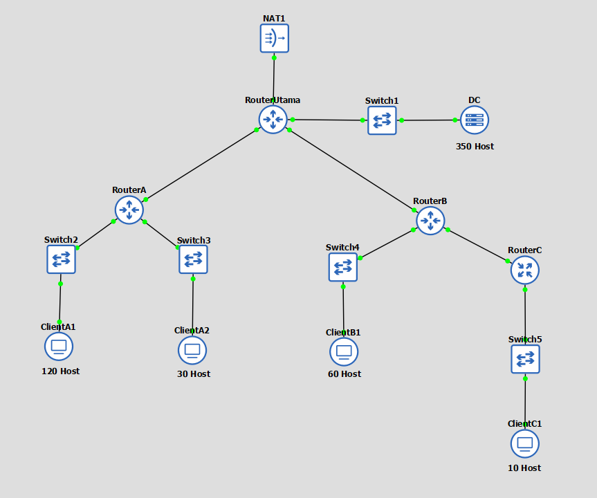
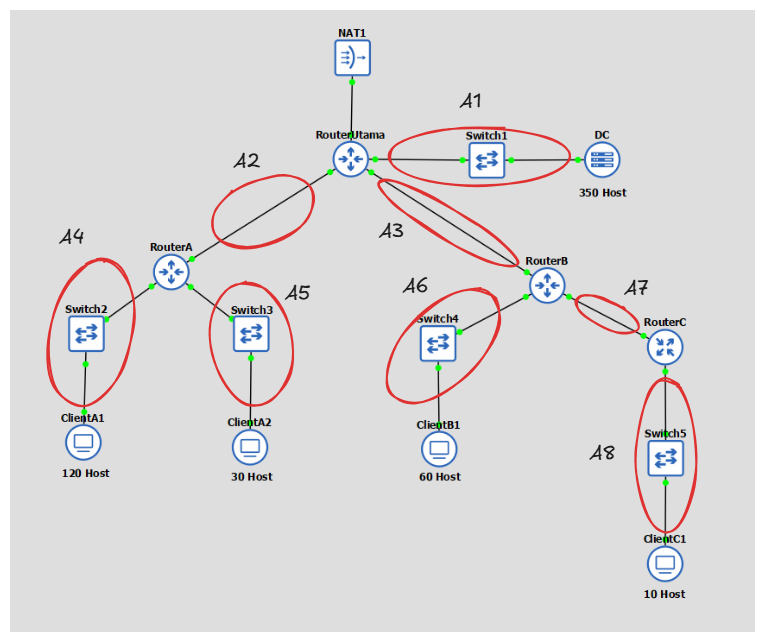
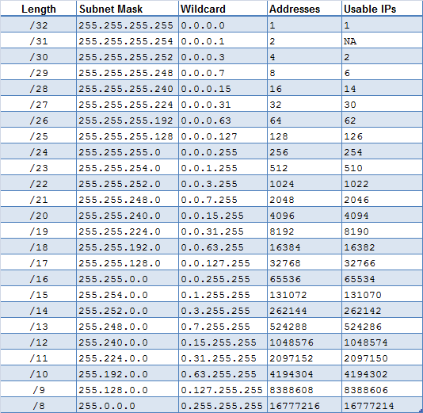
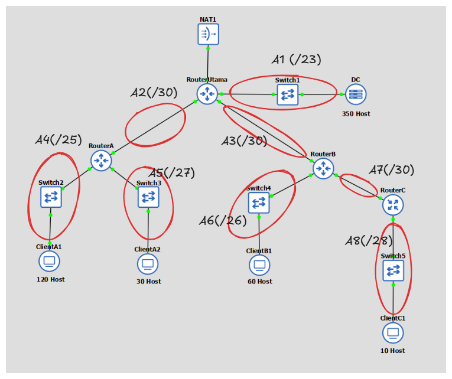
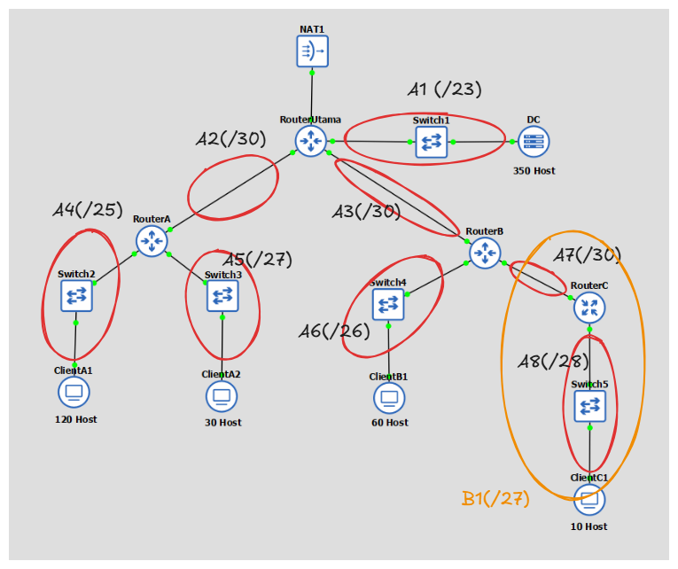
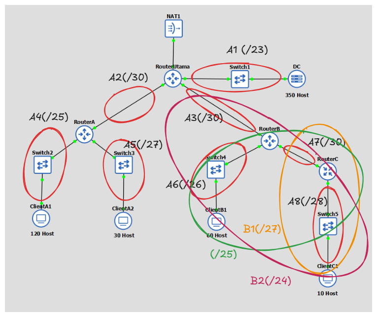
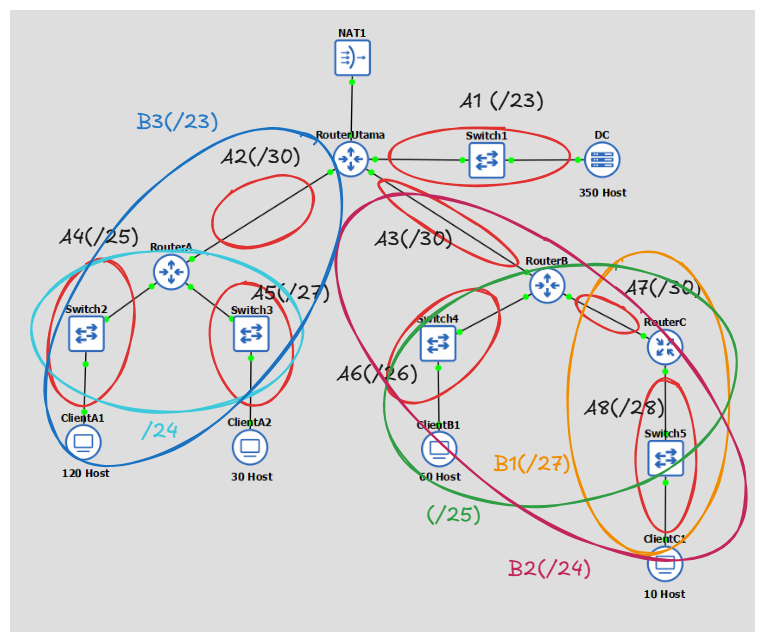
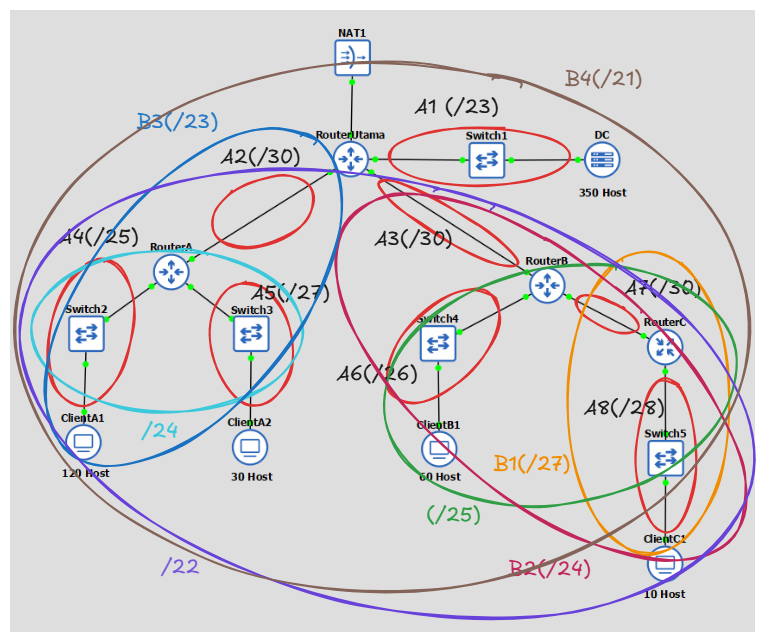

# NGE LATSOL YUKK

---

## Soal:

Diberikan topologi jaringan pada gambar di bawah ini:



Lakukan perancangan pengalamatan IP menggunakan base IP **`10.80.0.0`** dengan metode:
1. **Classful**
2. **VLSM (Variable Length Subnet Masking)**
3. **CIDR (Classless Inter-Domain Routing)**

---

## Penyelesaian:

### 1. Menentukan Jumlah Subnet & Kebutuhan Host

Berdasarkan batas interface router (lingkaran merah), terdapat **8 Subnet** pada topologi:



Rincian kebutuhan host untuk setiap subnet (termasuk 1 IP untuk interface router sebagai gateway):
* **A1** (RouterUtama - Switch1 - DC) : 350 Server + 1 Gateway = **351 Host**
* **A2** (RouterUtama - RouterA) : **2 Host** (Point-to-Point)
* **A3** (RouterUtama - RouterB) : **2 Host** (Point-to-Point)
* **A4** (RouterA - Switch2 - ClientA1) : 120 PC + 1 Gateway = **121 Host**
* **A5** (RouterA - Switch3 - ClientA2) : 29 PC + 1 Gateway = **30 Host**
* **A6** (RouterB - Switch4 - ClientB1) : 60 PC + 1 Gateway = **61 Host**
* **A7** (RouterB - RouterC) : **2 Host** (Point-to-Point)
* **A8** (RouterC - Switch5 - ClientC1) : 10 PC + 1 Gateway = **11 Host**

---

### 2. Subnetting Classful

Pada metode **Classful**, penentuan netmask bersifat kaku dan terikat pada **3 kelas utama** alamat IP:

| Class | Default Netmask | Kapasitas Host Usable |
|---|---|---|
| **Class A** | `/8` (255.0.0.0) | 16.777.214 |
| **Class B** | `/16` (255.255.0.0) | 65.534 |
| **Class C** | `/24` (255.255.255.0) | 254 |


#### Pembagian IP Subnet Classful (Base IP: 10.80.0.0):

| Subnet | Parameter | Nilai Alamat IP / Subnet Mask |
| :---: | :--- | :--- |
| **A1** | Network ID | 10.80.0.0 |
| | Netmask | 255.255.0.0 |
| | Broadcast Address | 10.80.255.255 |
| **A2** | Network ID | 10.80.1.0 |
| | Netmask | 255.255.255.0 |
| | Broadcast Address | 10.80.1.255 |
| **A3** | Network ID | 10.80.2.0 |
| | Netmask | 255.255.255.0 |
| | Broadcast Address | 10.80.2.255 |
| **A4** | Network ID | 10.80.3.0 |
| | Netmask | 255.255.255.0 |
| | Broadcast Address | 10.80.3.255 |
| **A5** | Network ID | 10.80.4.0 |
| | Netmask | 255.255.255.0 |
| | Broadcast Address | 10.80.4.255 |
| **A6** | Network ID | 10.80.5.0 |
| | Netmask | 255.255.255.0 |
| | Broadcast Address | 10.80.5.255 |
| **A7** | Network ID | 10.80.6.0 |
| | Netmask | 255.255.255.0 |
| | Broadcast Address | 10.80.6.255 |
| **A8** | Network ID | 10.80.7.0 |
| | Netmask | 255.255.255.0 |
| | Broadcast Address | 10.80.7.255 |


---

### 3. Subnetting Classless - VLSM (Top-Down)

Inti utama dari teknik VLSM adalah mengefisienkan pembagian IP di dalam jaringan. Besar netmask disesuaikan dengan banyaknya komputer/host yang membutuhkan alamat IP.

#### Langkah 1 - Menentukan Jumlah IP dan Labelling Netmask

Sebagai acuan untuk menentukan panjang prefix (/netmask) berdasarkan jumlah IP yang dibutuhkan, kita dapat menggunakan tabel referensi berikut:



Urutkan kebutuhan alamat IP tiap subnet (termasuk 1 IP untuk router) dari yang terbesar ke terkecil:

| Subnet | Jumlah IP | Netmask |
|---|---|---|
| **A1** | 351 | /23 |
| **A4** | 121 | /25 |
| **A6** | 61 | /26 |
| **A5** | 30 | /27 |
| **A8** | 11 | /28 |
| **A2** | 2 | /30 |
| **A3** | 2 | /30 |
| **A7** | 2 | /30 |
| **Total** | **580** | **/22** |


---

#### Langkah 2 - Konstruksi Pohon Biner VLSM

Dimulai dari root **`10.80.0.0/22`** (kapasitas 1024 IP):

```text
                                [ 10.80.0.0/22 ] (1024 IP)
                                            │
                    ┌───────────────────────┴───────────────────────┐
                    │                                               │
          [ 10.80.0.0/23 ] (512 IP)                       [ 10.80.2.0/23 ] (512 IP)
            ★ A1 (DC: 351 Host)                                            │
                                                    ┌──────────────────────┴──────────────────────┐
                                                    │                                             │
                                          [ 10.80.2.0/24 ] (256 IP)                     [ 10.80.3.0/24 ] (256 IP)
                                                    │                                           (Reserved)
                                 ┌──────────────────┴──────────────────┐
                                 │                                     │
                       [ 10.80.2.0/25 ] (128 IP)             [ 10.80.2.128/25 ] (128 IP)
                         ★ A4 (ClientA1: 121 Host)                             │
                                                        ┌──────────────────────┴──────────────────────┐
                                                        │                                             │
                                              [ 10.80.2.128/26 ] (64 IP)                    [ 10.80.2.192/26 ] (64 IP)
                                                ★ A6 (ClientB1: 61 Host)                                  │
                                                                                       ┌──────────────┴──────────────┐
                                                                                       │                             │
                                                                             [ 10.80.2.192/27 ] (32 IP)    [ 10.80.2.224/27 ] (32 IP)
                                                                               ★ A5 (ClientA2: 30 Host)                    │
                                                                                                            ┌──────────────┴──────────────┐
                                                                                                            │                             │
                                                                                                  [ 10.80.2.224/28 ] (16 IP)    [ 10.80.2.240/28 ] (16 IP)
                                                                                                    ★ A8 (ClientC1: 11 Host)                    │
                                                                                                                           ┌────────────┴────────────┐
                                                                                                                           │                         │
                                                                                                                 [ 10.80.2.240/29 ] (8 IP)  [ 10.80.2.248/29 ] (8 IP)
                                                                                                                           │                         │
                                                                                                                    ┌──────┴──────┐           ┌──────┴──────┐
                                                                                                                    │             │           │             │
                                                                                                                 /30 (4 IP)    /30 (4 IP)  /30 (4 IP)    /30 (Reserved)
                                                                                                                  ★ A2 (Link)   ★ A3 (Link) ★ A7 (Link)
```

---

#### Langkah 3 - Tabel Alokasi Pengalamatan IP VLSM Lengkap

| Subnet | Network ID (NID) | Netmask | Broadcast Address | Range IP (Host Usable) | Jumlah Host |
|---|---|---|---|---|---|
| **A1** | `10.80.0.0` | `255.255.254.0` (/23) | `10.80.1.255` | `10.80.0.1 - 10.80.1.254` | 351 Host |
| **A4** | `10.80.2.0` | `255.255.255.128` (/25) | `10.80.2.127` | `10.80.2.1 - 10.80.2.126` | 121 Host |
| **A6** | `10.80.2.128` | `255.255.255.192` (/26) | `10.80.2.191` | `10.80.2.129 - 10.80.2.190` | 61 Host |
| **A5** | `10.80.2.192` | `255.255.255.224` (/27) | `10.80.2.223` | `10.80.2.193 - 10.80.2.222` | 30 Host |
| **A8** | `10.80.2.224` | `255.255.255.240` (/28) | `10.80.2.239` | `10.80.2.225 - 10.80.2.238` | 11 Host |
| **A2** | `10.80.2.240` | `255.255.255.252` (/30) | `10.80.2.243` | `10.80.2.241 - 10.80.2.242` | 2 Host |
| **A3** | `10.80.2.244` | `255.255.255.252` (/30) | `10.80.2.247` | `10.80.2.245 - 10.80.2.246` | 2 Host |
| **A7** | `10.80.2.248` | `255.255.255.252` (/30) | `10.80.2.251` | `10.80.2.249 - 10.80.2.250` | 2 Host |


---

### 4. Subnetting Classless - CIDR (Bottom-Up)

Perhitungan pada teknik **CIDR** didasarkan pada penggabungan subnet dari bawah ke atas (*bottom-up*). Paling bawah berarti subnet yang letaknya paling jauh dari internet / router utama.

> **Aturan Penggabungan CIDR:**  
> Subnet gabungan akan memiliki netmask **1 tingkat di atas subnet terbesar yang digabungkan** (misal: jika subnet terbesar yang digabungkan adalah /28, maka subnet gabungan menjadi /27).

---

#### Langkah 1 - Labelling Netmask Tiap Subnet pada Topologi

Tentukan subnet yang ada dalam topologi dan lakukan *labelling* netmask terhadap masing-masing subnet sesuai kebutuhan host-nya:
* **A1** (Data Center) = /23
* **A2** (Link Utama - A) = /30
* **A3** (Link Utama - B) = /30
* **A4** (Client A1) = /25
* **A5** (Client A2) = /27
* **A6** (Client B1) = /26
* **A7** (Link B - C) = /30
* **A8** (Client C1) = /28



---

#### Langkah 2 - Penggabungan Subnet Bertingkat (Bottom-Up)

Gabungkan subnet dari yang paling bawah (paling jauh dari RouterUtama / internet) secara bertingkat:

##### Level 1 
Subnet yang posisinya paling jauh adalah pada RouterC, yaitu **A8 (/28)** dan **A7 (/30)**:
* Gabungin A8 ama A7
* Subnet terbesar adalah **/28** $\rightarrow$ Naik 1 tingkat menjadi **Subnet B1 (/27)**.



---

##### Level 2
Gabungkan hasil dari RouterC (**Subnet B1 /27**) dengan **A6 (/26)** dan link **A3 (/30)**:
* Subnet terbesar antara B1 (/27) dan A6 (/26) adalah **/26** $\rightarrow$ Naik 1 tingkat menjadi /25.
* Lalu digabungkan dengan link **A3 (/30)** $\rightarrow$ Naik 1 tingkat lagi menjadi **Subnet B2 (/24)**.



---

##### Level 2 
Pada sisi Cabang RouterA, gabungkan **A4 (/25)**, **A5 (/27)**, dan link **A2 (/30)**:
* Subnet terbesar antara A4 (/25) dan A5 (/27) adalah **/25** $\rightarrow$ Naik 1 tingkat menjadi /24.
* Lalu digabungkan dengan link **A2 (/30)** $\rightarrow$ Naik 1 tingkat lagi menjadi **Subnet B3 (/23)**.



---

##### Level 3 
Gabungkan seluruh blok cabang (**Subnet B3 /23** dan **Subnet B2 /24**), lalu satukan dengan **A1 (/23)**:
* Subnet terbesar antara B3 (/23) dan B2 (/24) adalah **/23** $\rightarrow$ Naik 1 tingkat menjadi /22.
* Terakhir, digabungkan dengan **A1 (/23)**. Subnet terbesar adalah **/23** $\rightarrow$ Naik 1 tingkat menjadi **ROOT SUPERNET CIDR: /21** (kapasitas 2048 IP).



---

#### Langkah 3 - Penentuan Supernet Besar

Dari proses penggabungan bertingkat yang telah dilakukan, didapatkan sebuah subnet besar (Supernet) yang mencakup seluruh topologi dengan netmask **/21**.  
* **Network ID**: 10.80.0.0
* **Netmask**: 255.255.248.0 (/21)
* **Broadcast Address**: 10.80.7.255
* **Rentang IP**: 10.80.0.1 s.d. 10.80.7.254 (Kapasitas 2046 Host)

---

#### Langkah 4 - Pohon Hirarki CIDR

Hitung pembagian IP dengan pohon hirarki berdasarkan penggabungan subnet bertingkat yang telah dilakukan:

```text
                                                 [ 10.80.0.0/21 ] (2048 IP) (ROOT SUPERNET)
                                                                     │
                         ┌───────────────────────────────────────────┴───────────────────────────────────────────┐
                         │                                                                                       │
             [ 10.80.0.0/22 ] (1024 IP)                                                              [ 10.80.4.0/22 ] (1024 IP)
                         │                                                                                       │
          ┌──────────────┴──────────────┐                                                         ┌──────────────┴──────────────┐
          │                             │                                                         │                             │
[ 10.80.0.0/23 ] (512 IP)     [ 10.80.2.0/23 ] (512 IP)                                 [ 10.80.4.0/24 ] (256 IP)     [ 10.80.5.0 - 10.80.7.255 ]
  └── A1 (DC: 351 Host)        (Subnet B3 - Cabang RouterA)                              (Subnet B2 - Cabang RouterB&C)  (768 IP - Reserved Supernet)
                                        │                                                         │
                         ┌──────────────┴──────────────┐                           ┌──────────────┴──────────────┐
                         │                             │                           │                             │
             [ 10.80.2.0/24 ] (256 IP)     [ 10.80.3.0/24 ] (256 IP)   [ 10.80.4.0/26 ] (64 IP)      [ 10.80.4.64/26 ] (64 IP)
                         │                  (Reserved Cabang A)          └── A6 (ClientB1: 61 Host)              │
          ┌──────────────┴──────────────┐                                                         ┌──────────────┴──────────────┐
          │                             │                                                         │                             │
[ 10.80.2.0/25 ] (128 IP)     [ 10.80.2.128/25 ] (128 IP)                               [ 10.80.4.64/30 ] (4 IP)      [ 10.80.4.128/27 ] (32 IP)
  └── A4 (ClientA1: 121 Host)           │                                                 └── A3 (Link Utama - B)       (Subnet B1 - Ranting RouterC)
                               ┌────────┴────────┐                                                                      │
                               │                 │                                                       ┌──────────────┴──────────────┐
                   [ 10.80.2.128/27 ] (32 IP) [ 10.80.2.160/27 ]                                         │                             │
                     └── A5 (ClientA2: 30 Host)          │                                     [ 10.80.4.128/28 ] (16 IP)    [ 10.80.4.144/28 ] (16 IP)
                                                ┌────────┴────────┐                              └── A8 (ClientC1: 11 Host)            │
                                                │                 │                                                             ┌──────┴──────┐
                                     [ 10.80.2.160/30 ] (4 IP) [ Cadangan ]                                                     │             │
                                       └── A2 (Link Utama - A)                                                       [ 10.80.4.144/30 ] (4 IP)  [ Cadangan ]
                                                                                                                       └── A7 (Link B - C)
```


---

#### Langkah 5 - Tabel Alokasi Pembagian IP CIDR Lengkap

| Subnet / Blok Supernet | Network ID | Netmask | Broadcast Address | Range IP (Host Usable) | Keterangan & Anggota |
|---|---|---|---|---|---|
| **A1 (Data Center)** | 10.80.0.0 | 255.255.254.0 (/23) | 10.80.1.255 | 10.80.0.1 - 10.80.1.254 | LAN Data Center (351 Host) |
| **Blok Cabang A (/23)** | 10.80.2.0 | 255.255.254.0 (/23) | 10.80.3.255 | 10.80.2.1 - 10.80.3.254 | **Supernet Cabang RouterA (B3)** |
| ↳ **A4** (Client A1) | 10.80.2.0 | 255.255.255.128 (/25) | 10.80.2.127 | 10.80.2.1 - 10.80.2.126 | LAN Client A1 (121 Host) |
| ↳ **A5** (Client A2) | 10.80.2.128 | 255.255.255.224 (/27) | 10.80.2.159 | 10.80.2.129 - 10.80.2.158 | LAN Client A2 (30 Host) |
| ↳ **A2** (Link Utama - A) | 10.80.2.160 | 255.255.255.252 (/30) | 10.80.2.163 | 10.80.2.161 - 10.80.2.162 | Point-to-Point Link (2 Host) |
| ↳ *Cadangan Cabang A* | 10.80.2.164 | - | 10.80.3.255 | 10.80.2.164 - 10.80.3.254 | Sisa ruang untuk ekspansi divisi di RouterA |
| **Blok Cabang B & C (/24)** | 10.80.4.0 | 255.255.255.0 (/24) | 10.80.4.255 | 10.80.4.1 - 10.80.4.254 | **Supernet Cabang RouterB & C (B2)** |
| ↳ **A6** (Client B1) | 10.80.4.0 | 255.255.255.192 (/26) | 10.80.4.63 | 10.80.4.1 - 10.80.4.62 | LAN Client B1 (61 Host) |
| ↳ **A3** (Link Utama - B) | 10.80.4.64 | 255.255.255.252 (/30) | 10.80.4.67 | 10.80.4.65 - 10.80.4.66 | Point-to-Point Link (2 Host) |
| ↳ **A8** (Client C1) | 10.80.4.128 | 255.255.255.240 (/28) | 10.80.4.143 | 10.80.4.129 - 10.80.4.142 | LAN Client C1 (11 Host) |
| ↳ **A7** (Link B - C) | 10.80.4.144 | 255.255.255.252 (/30) | 10.80.4.147 | 10.80.4.145 - 10.80.4.146 | Point-to-Point Link (2 Host) |
| ↳ *Cadangan Cabang B & C* | 10.80.4.148 | - | 10.80.4.255 | 10.80.4.148 - 10.80.4.254 | Sisa ruang untuk ekspansi divisi di RouterB & C |

---

### 5. Perbandingan Komprehensif: Classful vs VLSM vs CIDR

| Parameter | Classful | Classless - VLSM | Classless - CIDR |
|---|---|---|---|
| **Dasar Penentuan Mask** | Kelas IP Standar (A/B/C) | Kebutuhan Host ($2^h - 2 \ge N$) | Agregasi Geografis & Topologi |
| **Variasi Netmask Hasil** | `/16` dan `/24` saja | Beragam: `/23, /25, /26, /27, /28, /30` | Blok Supernet: `/21, /23, /24, /27` |
| **Ukuran Supernet Utama** | Terpecah antar kelas | **`/22`** (1024 IP) | **`/21`** (2048 IP) |
| **Efisiensi Alokasi IP** | Sangat Boros (66.726 IP terbuang) | **Tertinggi (Sangat Hemat)** | Seimbang (Efisien + Ruang Cadangan) |
| **Dampak ke Tabel Routing** | Banyak rute `/24` dan `/16` | Perlu rute detail untuk setiap subnet | **Route Summarization** (Tabel sangat ringkas) |
| **Skalabilitas Subnet Baru** | Sulit, boros ruang | Mengharuskan hitung ulang pohon | **Mudah**, langsung pakai IP di blok cabang |

---

